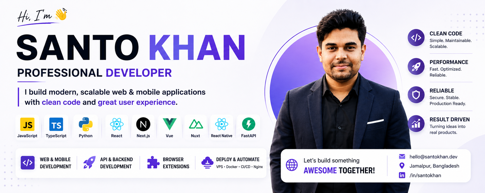

<h1>I'm Santo.</h1>

<h3>Full Stack Developer | AI Integration &amp; Automation | API &amp; Browser Extension Development</h3>

I build web applications, backend APIs, and browser extensions, with extensive experience in API development using FastAPI, Express.js, and NestJS, backed by PostgreSQL and MySQL.

My work includes JWT-based authentication and Google OAuth integrations for Google Sign-In and email access. I also specialize in browser extension development and Chromium browser automation using Playwright and Electron.

I integrate AI capabilities into applications, implement retrieval-augmented generation (RAG), and develop messaging automation for Messenger, WhatsApp, and Telegram.

I deploy and maintain applications on Linux and Ubuntu servers, configure Nginx web servers and reverse proxies, and manage application services with systemd. My infrastructure toolkit also includes Bash scripting, Docker, Cloudflare, and DigitalOcean.

I created <strong>Inply</strong>, a browser extension for EGP form filling, as part of my product portfolio.

Explore my services on <a href="https://www.fiverr.com/web__architect?up_rollout=true" title="Fiverr">Fiverr</a> and <a href="https://www.upwork.com/freelancers/~013de8e004b41e7e82" title="Upwork">Upwork</a>.

<strong>Connect with me:</strong> <a href="https://www.linkedin.com/in/santokhan1999/">LinkedIn</a> &middot; <a href="https://instagram.com/SantoKhan1999/">Instagram</a> &middot; <a href="https://wa.me/8801718787756">WhatsApp</a>

<h3>Skills</h3>

<h4>AI Integration &amp; Automation</h4>

<ul>
    <li>AI integration into applications and workflows</li>
    <li>Retrieval-augmented generation (RAG)</li>
    <li>Messaging automation for Messenger, WhatsApp, and Telegram</li>
    <li>Chromium browser automation using Playwright and Electron</li>
</ul>

| Category | Technologies & Skills |
| --- | --- |
| Markup | HTML5 |
| Styling | CSS, Tailwind CSS, Bootstrap |
| Programming Languages | JavaScript, Python, PHP |
| Frontend Frameworks | React, Next.js, Vue.js, Nuxt |
| Backend Frameworks | Express.js, NestJS, FastAPI |
| Databases | PostgreSQL, Redis, MongoDB, MySQL |
| Runtime & Package Management | Node.js, npm |
| Libraries & State Management | jQuery, TanStack Query (React Query), Redux, D3.js |
| Development Tools | Git, Vite, Prettier, Nodemon, Terminal |
| Platforms & Infrastructure | WordPress, Docker, Cloudflare, DigitalOcean, Heroku |
| Server Administration & Deployment | Linux, Ubuntu, Nginx, Bash, systemd service management |

<h3>Work Profiles</h3>

[Fiverr](https://www.fiverr.com/web__architect?up_rollout=true) &middot; [Upwork](https://www.upwork.com/freelancers/~013de8e004b41e7e82)

Thank you Santo

